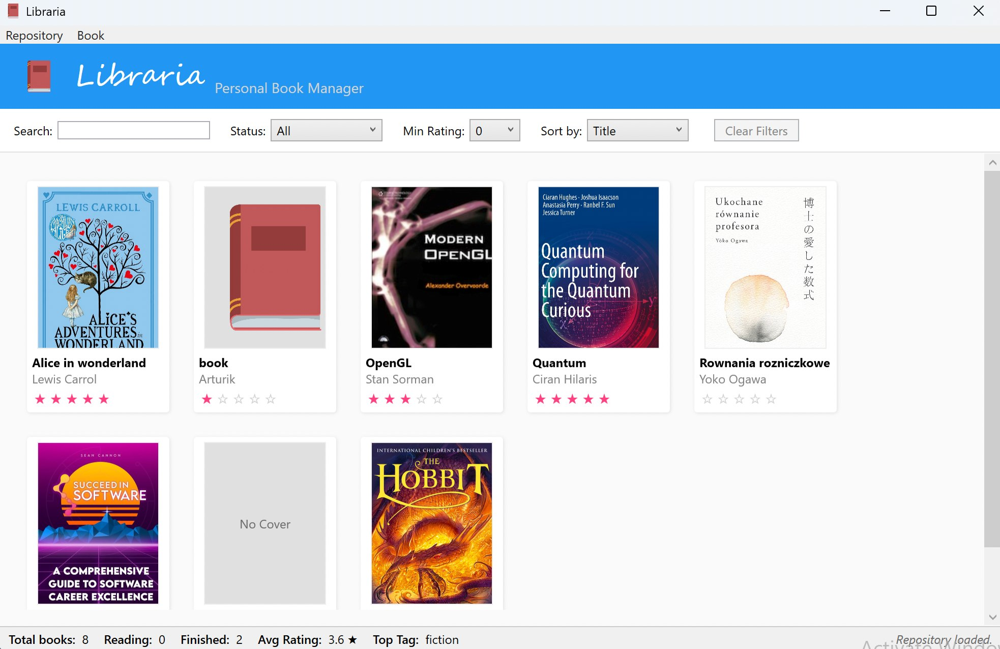
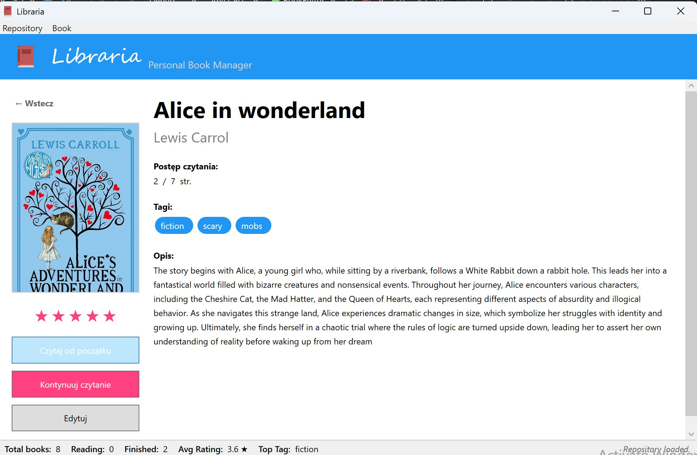
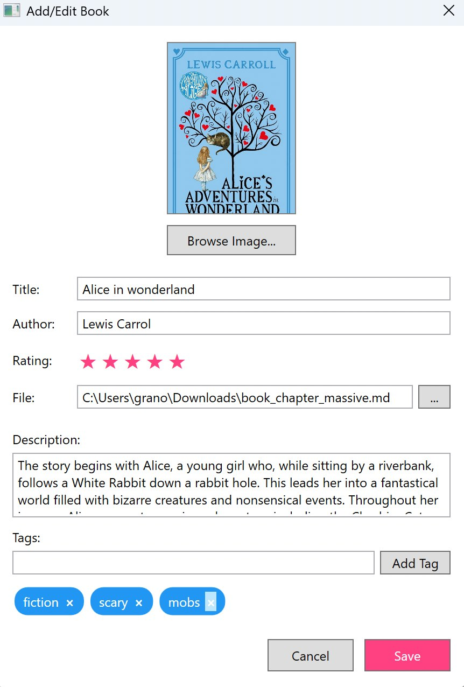
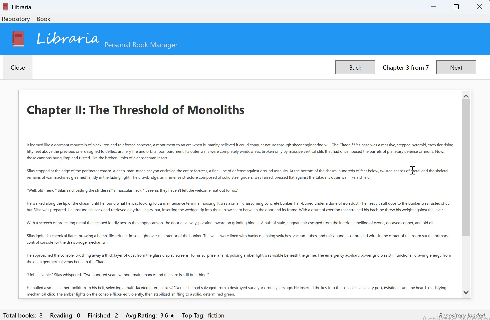
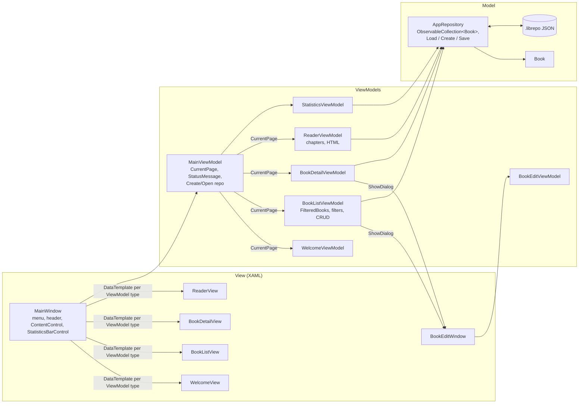
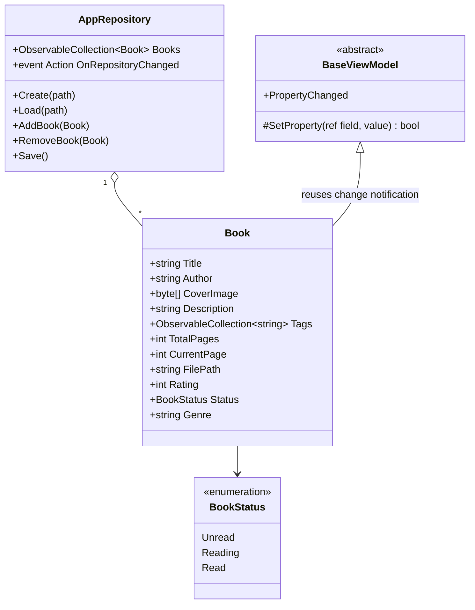

# Libraria

A WPF desktop application for managing a personal book collection and reading Markdown books
inside the app. Built on .NET 8 with an MVVM structure: a JSON-backed repository holds the
books, each screen is a ViewModel resolved to a View through `DataTemplate`, and every user
action is an `ICommand`. Covers are stored inline as bytes, reading progress and status are
tracked per book, and the status bar aggregates statistics live from the repository.

Developed as a project for the Object-Oriented Programming course at Warsaw University of
Technology.

## Preview

Screenshots of the application running on Windows 11 with the sample repository.



| Book details with progress, tags and reading actions | Add/Edit dialog with cover, rating, tags and file picker |
| :--: | :--: |
|  |  |



## Features

- **Repositories.** A library is a single `.librepo` file (JSON). Create a new one or open an
  existing one from the `Repository` menu; every change is written back immediately.
- **Library view.** Cover grid with live search by title or author, filters by reading status
  and minimum rating, sorting by title or author, and a `Clear Filters` action that is enabled
  only when a filter is active. Double-click opens a book; `Delete` removes the selected one.
- **Book details.** Cover, author, reading progress (`current / total` chapters), tag chips,
  description, and buttons to read from the beginning, continue reading, or edit.
- **Add/Edit dialog.** Title, author, five-star rating, cover image picker (PNG/JPEG), Markdown
  file picker, description, and tag management. `Save` is disabled until a title is entered.
- **Reader.** Splits the linked Markdown file into chapters at `#` and `##` headings, converts
  each chapter to HTML with a small regex converter and shows it in a `WebBrowser` control.
  Page position is saved to the book; opening a book sets it to `Reading`, reaching the last
  chapter sets it to `Read`.
- **Statistics bar.** Total books, books read or in progress, average rating of rated books,
  and the most frequent tag, recomputed on every repository change.

## Architecture



- **Navigation without a frame.** `MainViewModel.CurrentPage` holds the active ViewModel. A
  `ContentControl` bound to it picks the matching View through the `DataTemplate` mappings in
  `App.xaml`, so switching screens is an assignment, not a window operation.
- **Auto-save.** `AppRepository` subscribes to `CollectionChanged` on the book list and to
  `PropertyChanged` on every book and its tag collection. Any edit serialises the whole
  collection with `System.Text.Json` (indented) to the open `.librepo` file and raises
  `OnRepositoryChanged`, which the list and statistics ViewModels use to refresh.
- **Commands.** `RelayCommand` wraps `Action` or `Action<object?>` with an optional
  `CanExecute`, hooked into `CommandManager.RequerySuggested` so button states update
  automatically. Menu items bind to `CurrentPage.AddBookCommand` and friends, so they are only
  active on the list screen.
- **Edit dialog lifecycle.** `BookEditViewModel` works on a copy of the fields and writes them
  back to the original `Book` (or a new one) only on `Save`; a `CloseRequested` event lets the
  ViewModel close the modal window without referencing it.

### Data model



`Book` derives from `BaseViewModel` to get `INotifyPropertyChanged`, which is what makes the
auto-save and the live statistics possible. Covers are kept as a `byte[]` inside the JSON file
(base64), so a `.librepo` is self-contained and can be copied between machines.

### Custom controls

| Control | Dependency properties | Notes |
| --- | --- | --- |
| `RatingControl` | `Value`, `IsReadOnly`, `StarSize` | Five `StarItem`s with hover preview and click-to-rate; read-only mode switches the cursor and ignores clicks. |
| `TagControl` | `Tags`, `IsReadOnly`, `RemoveTagCommand`, `ChipBackground` | Pill chips in a `WrapPanel`; the remove button is hidden through a `DataTrigger` in read-only mode. |
| `StatisticsBarControl` | none (bound to `StatisticsViewModel`) | Bottom bar in `MainWindow`. |

Two helpers complete the binding story: `ByteArrayToImageConverter` turns the stored bytes into
a `BitmapImage` (`BitmapCacheOption.OnLoad`, so the stream can be disposed), and
`WebBrowserBehavior.Html` is an attached property that calls `NavigateToString` because
`WebBrowser` has no bindable source property.

## Getting started

### Prerequisites

- Windows 10 or 11 (WPF is Windows-only)
- [.NET SDK 8.0](https://dotnet.microsoft.com/download/dotnet/8.0) or newer, or Visual Studio
  2022 with the .NET desktop workload

### Run

```bash
git clone https://github.com/anniigr/e-Reader.git
cd e-Reader
dotnet run --project BookEditor
```

Or open `BookEditor.slnx` in Visual Studio 2022 17.10+ and press F5.

### First launch

1. Choose `Repository → Open` and select `1.librepo` from the repository root to load the
   sample library shown in the screenshots (seven books with covers), or `Repository → Create`
   to start an empty one.
2. `Book → Add...` opens the edit dialog. Pick a cover (PNG/JPEG) and, optionally, a Markdown
   file to read.
3. Double-click a book to open its details; `Czytaj od początku` starts the reader at chapter
   one, `Kontynuuj czytanie` resumes at the saved chapter.

Sample covers and two more `.librepo` files are in
`wpf3_granos_anna-master_SampleBookData-covers/`.

## Project structure

```
e-Reader/
├── BookEditor.slnx
├── 1.librepo                        # sample library (JSON, covers embedded)
├── Images/                          # screenshots used in this README
├── wpf3_granos_anna-master_SampleBookData-covers/   # sample covers and libraries
└── BookEditor/
    ├── App.xaml                     # brushes, ViewModel → View DataTemplates
    ├── MainWindow.xaml              # menu, header, page host, statistics bar
    ├── Models/                      # Book, AppRepository
    ├── ViewModels/                  # Main, Welcome, BookList, BookDetail, BookEdit, Reader, Statistics, RelayCommand, BaseViewModel
    ├── Views/                       # WelcomeView, BookListView, BookDetailView, ReaderView, BookEditWindow
    ├── Controls/                    # RatingControl, TagControl, StatisticsBarControl
    ├── Converters/                  # ByteArrayToImageConverter
    └── Helpers/                     # WebBrowserBehavior
```

## Limitations and known issues

- **Windows only, no automated tests.** The project targets `net8.0-windows` with WPF; it
  cannot be built or run on macOS or Linux, and there is no test project.
- **Markdown only.** The reader opens `.md` files (the file picker filters for them) and
  supports headings, bold, italic and inline code. PDF and EPUB are not supported.
- **Sorting by rating does not work.** `BookListViewModel.ApplyFilters` matches the sort key
  `"Ocena"` while the option offered in the UI is `"Rating"`, so choosing it falls back to
  sorting by title.
- **Whole-file saves.** Every property change rewrites the entire `.librepo`, including all
  cover bytes. Fine for a personal library, slow for thousands of books with large covers.
- **No delete confirmation.** `Delete` removes the selected book immediately.
- **Mixed-language UI.** Buttons and labels are a mix of English and Polish.
- **`WebBrowser` is the legacy IE-based control.** It renders the generated HTML adequately but
  is deprecated in favour of WebView2.
